# HNDL `v0.9.0` Multi-Subagent Architecture & Product Review

- **Date:** 2026-10-23
- **Version Reviewed:** `0.9.0` (`develop` / `v0.9.0`, commit `d5e77a9`, 78 built-in operators, 21 network recipes)
- **Review Tracks:**
  1. Performance & Runtime Efficiency
  2. Comprehensiveness & SOTA Architecture Coverage
  3. Extensibility & Ecosystem Interoperability
  4. User-Friendliness, Developer Experience (DX), & Tooling
  5. Correctness Audit, Training/Inference Lifecycle, & `v1.0` Readiness

---

## Executive Summary

HNDL `v0.9.0` has an exceptional architectural foundation: a zero-execution declarative parser (`src/hndl/_parser.py`), a monotone bidirectional constraint solver (`src/hndl/resolver.py`), canonical plan persistence with `since=` schema evolution (`src/hndl/types.py`), once-per-signature runtime contract verification (`src/hndl/torch.py`), and 100% mathematical `_reference` oracle coverage across all non-pretrained operators (`src/hndl/testing.py`).

To become the **definitive `v1.0` neural architecture definition and compilation library**, HNDL should close three gaps surfaced by the 5-agent audit:

1. **Remediate 10 concrete correctness & numerical bugs in `v0.9.0`** (including a `GraphModule` runtime crash when `cast` outputs non-compute dtypes, `FakeTensor` cache poisoning under `torch.compile` in `rope`/`attention`/`latent_attention`, `float16` `NaN`s in `gated_delta_attention` backward and `grn` forward, non-monotone rank-3 guessing in `matmul`, and scrambled spatial axes in `dit_tiny.hndl`).
2. **Optimize SOTA operator execution & unlock real-world model composition** (replace Python expert loops and dense `torch.compile` evaluation in `moe` with grouped GEMMs, eliminate 5D `[B, H, C, C, D_h]` tensor materializations in `gated_delta_attention`, support declarative `.hndl` constants/macros, and allow weight tying & post-build LoRA/quantization).
3. **Exploit HNDL's static `ResolvedPlan` superpower** (zero-compute static profiling of parameters, FLOPs, liveness-simulated peak activation memory, and KV-cache footprint via `plan.profile()`, plus IDE `.pyi` stubs for `hndl.ops`, Mermaid graph export, standalone PyTorch codegen, and training/inference lifecycle hooks).

```mermaid
flowchart LR
    subgraph v091["Phase 1: v0.9.1 Hotfix & Hardening"]
        B1["Fix 10 v0.9.0 Bugs (cast, RoPE compile cache, fp16 NaNs, matmul, conv1d)"]
        B2["Fix dit_tiny.hndl & deepseek_moe_tiny.hndl"]
        B3["Cross-Op torch.compile + fp16 Backward Stress Matrix"]
    end
    subgraph v010["Phase 2: v0.10.0 Performance & DX"]
        P1["MoE Grouped GEMM & GDA 4D Tensor Core Vectorization"]
        P2[".hndl Constants, Macros (def), & Tuple Loops"]
        P3["capture.pyi IDE Stubs, Fuzzy Diagnostics & Provenance Chains"]
        P4["CLI (hndl inspect / mermaid) & Static plan.profile()"]
    end
    subgraph v100["Phase 3: v1.0.0 Production & Ecosystem"]
        E1["Weight Tying, LoRA/PEFT State Rebinding & Safetensors Loader"]
        E2["model.param_groups(), Checkpointing & Depth-Scaled Init"]
        E3["Stateful KV / MLA / GDA Inference Cache & plan.to_python_source()"]
        E4["Mamba-2 (SSD), Joint Attention (MMDiT), 2D RoPE & Rank-5 Support"]
    end
    v091 --> v010 --> v100
```

---

## 0. Urgent: 10 Verified Code-Level Bugs in `v0.9.0`

> [!CAUTION]
> The subagents discovered **10 reproducible bugs and contract defects** introduced or exposed in `v0.9.0`. These should be fixed first.

| # | Severity | Component & Location | Defect & Reproducer Summary | Fix |
| :--- | :--- | :--- | :--- | :--- |
| **B-01** | **Critical** | `cast` + `GraphModule` `src/hndl/torch.py:36, 258-265, 360-370` `src/hndl/operators/cast.py:37, 58` | 1. `resolver.py:194-196` special-cases `cast` to propagate `node.args["dtype"]`, but `torch.py:263` does not—it maps `out[B, ...]:any` to `plan.dtype` (`float32`). Calling `model(x=x)` on any graph outputting `cast("int64")` or `cast("bool")` crashes with `E_RUNTIME: expected dtype float32, got int64`. 2. `DTYPES` in `torch.py:36` omits `"float64"` (raises `KeyError` when `cast("float64")` is used). 3. `Cast.__init__` registers a persistent buffer `_sink` (`cast.py:58`), polluting `model.state_dict()`. | Resolve `cast` port dtype in `Operator.port_dtype(port, compute, args)` so `resolver.py` and `torch.py` share one source of truth; distinguish symbolic `"compute"` ports from fixed-dtype `cast` ports in `_effective_dtype`; use an unregistered `_prototype` tensor (like `Constant`). |
| **B-02** | **Critical** | RoPE Caches under `torch.compile` `src/hndl/operators/rope.py:103-118` `src/hndl/operators/attention.py:377-389` `src/hndl/operators/latent_attention.py:241-269` | Running `torch.compile(model)(x=x)` traces under `FakeTensorMode` and writes `FakeTensor`s into `self._cache` / `self._rope_cache`. Any subsequent eager call `model(x=x)` hits the cache and crashes PyTorch (`AssertionError: Please convert all Tensors to FakeTensors first`). Also, `_apply()` (`.to()`/`.cpu()`) never clears the dict, leaking GPU tensors on device transfers. | Skip reading/writing `_cache` when `torch.compiler.is_compiling()` is true; clear `_cache` in `_apply()`; cache only the max sequence length per `(device, dtype)` and slice `[:T]`. |
| **B-03** | **High** | `gated_delta_attention` `fp16` Backward `NaN` `src/hndl/operators/gated_delta_attention.py:299-305, 325-377` | When $\alpha, \beta \to 0$ in `float16`, `F.rms_norm` scales backward gradients by $1/\sqrt{\epsilon} = 1000$ while `E` has magnitude $\sim 100$, causing `grad_B_mat = grad_o_intra @ E.T` to overflow `float16` ($10^5 > 65504 \to \infty$) before multiplying by `bj = 0.0` ($\infty \times 0 = \text{NaN}$). Also, lines 300/327 compute `log(exp(...))` through `float16`, losing precision. | Compute `log_alpha = -rate.float() * F.softplus(a_logits.float())` directly in `float32` and keep `_chunk_forward`'s intra/inter-chunk recurrence in `float32` before casting back to `orig_dtype`. |
| **B-04** | **High** | `grn` & `sinusoidal_embed` in `fp16` `src/hndl/operators/grn.py:61-64` `src/hndl/operators/sinusoidal_embed.py:97-109` | 1. `GRN.forward` computes `torch.sum(x**2, dim=(2, 3))` in `float16`, overflowing to `inf` when $H \times W \ge 1024$ and $|x| \sim 10$, which produces `nx = inf / inf = NaN` and `0.0 * NaN = NaN` even at initialization (`gamma = 0`). 2. `SinusoidalEmbed` registers `freqs` as a floating buffer that `construct()` downcasts to `float16`, causing a **43.6% error** at $t = 999$ vs `_reference`. | In `GRN.forward`, accumulate `gx` and `nx` in `float32` (like `RMSNorm`). In `SinusoidalEmbed`, keep `freqs` and `angles` in `float32` before casting `cat([sin, cos])` to `x.dtype`. |
| **B-05** | **High** | `matmul._relation` Non-Monotone Rank Guess `src/hndl/operators/matmul.py:7-17, 53-59` | When input ranks are unknown on Sweep 0 (`a = reshape(2, 4); b = reshape(2, 4)`), the `else: s.rank(..., 3)` branch guesses rank 3 before backward propagation can propagate rank 4 from `output_shape`, raising `E_CONSTRAINT: Rank conflict: 4 versus 3`. Also, the docstring at lines 53–59 still claims only rank 3 is supported. | Delete the `else: s.rank(..., 3)` branch in `matmul._relation` (`_Solver.patterns` already handles rank $\ge 3$ once any port rank is known) and update the docstring. |
| **B-06** | **High** | `conv1d(causal=True, stride > 1)` Premature `E_AMBIGUOUS` `src/hndl/operators/conv1d.py:40-44` | On Sweep 0 when `in_len is None` and `out_len` is known with `stride > 1`, `conv1d._relation` immediately calls `s.error("E_AMBIGUOUS", ...)` instead of recording `s.interval("x", length_axis, (out_len - 1) * stride + 1, out_len * stride)`, blocking upstream nodes (like `reshape`) from resolving `in_len` on the next sweep. | Replace `s.error("E_AMBIGUOUS", ...)` with `s.interval("x", length_axis, (out_len - 1) * stride + 1, out_len * stride)`. |
| **B-07** | **High** | `pretrained` Monkey-Patch & `contract="ids"` Multi-Output Crash `src/hndl/pretrained.py:357-451` `src/hndl/operators/pretrained.py:26-28` `src/hndl/registry.py:107` | 1. `Registry.pretrained_provider` in `registry.py:107` lacks `contract=` and `shape_fn=`; `pretrained.py:449` monkey-patches `Registry` only when `Registry.builtins()` is called. Calling `Registry().pretrained_provider(..., contract="ids")` on a fresh `Registry()` raises `TypeError`. 2. In `operators/pretrained.py:26`, `contract.kind == "ids"` calls `s.shape("out")`, crashing with `E_REGISTRY: unknown port 'out'` when `layers=('l1', 'l2')` creates ports `out0, out1`. | Move the full `pretrained_provider` implementation into `src/hndl/registry.py`; guard `s.shape("out")` by checking `len(args["layers"]) <= 1` and `not isinstance(provider, LocalProvider)`. |
| **B-08** | **High** | `dit_tiny.hndl` Scrambled Axes & Dead Params; `deepseek_moe_tiny.hndl` Outdated Args `examples/networks/dit_tiny.hndl:16-19` `examples/networks/deepseek_moe_tiny.hndl:10` | 1. `dit_tiny.hndl` reshapes `normed_out` (`[B, N=64, D=128]`) directly to `[B, C=128, H=8, W=8]` without `transpose(1, 2)`, scrambling spatial tokens into channels! Also `normed_out, _ = adaln_zero(...)` leaves 1/3 of `final_adaln`'s parameters (`16,512` weights) dead with zero gradient. 2. `deepseek_moe_tiny.hndl` uses `moe(..., activation="silu")` instead of `expert_kind="swiglu", bias=False, scoring="sigmoid"`. | Add `transpose(1, 2)` before `reshape(128, 8, 8)` in `dit_tiny.hndl`, add `gate=False` option to `adaln_zero` (or use `adaptive_norm`), and update `deepseek_moe_tiny.hndl`. |
| **B-09** | **Medium** | Multi-Output Unpacking Rejects Multiple `_` Targets `src/hndl/_parser.py:209-211` `src/hndl/config.py:60` | `names = [item.id for item in elements]; if len(set(names)) != len(names): self.reject("Unpacking targets must be distinct")` rejects valid Python unpacking `a, _, _ = chunk(3)` and binds `"_"` into `self.locals`. | Exclude `"_"` (`LOOP_TARGET`) from the duplicate check in `_parser.py:210` and skip binding `"_"` in `config.py:60`. |
| **B-10** | **Medium** | `l2_norm` Missing `dim` Validation, `transformer_block` Stale Docstring & Missing `eps`, Missing `extra_repr()` `src/hndl/operators/l2_norm.py:21-35` `src/hndl/operators/transformer_block.py:172-174, 199` | 1. `l2_norm` has no `_relation`, allowing `l2_norm(dim=0)` (batch-axis normalization!) and `l2_norm(dim=99)` to pass `resolve()`. 2. `transformer_block.py:172-174` docstring says `swiglu` and `rope` are unsupported, and line 199 fails to pass `eps=eps` to `Attention`. 3. All 8 new non-conv `v0.9.0` modules omit `extra_repr()`. | Add `_relation` to `l2_norm` (matching `softmax`), pass `eps=eps` and update docstring in `transformer_block`, and implement `extra_repr()` on the 8 new `v0.9.0` operators. |

---

## 1. Performance & Runtime Efficiency

### What Already Shines
- **Once-per-signature validation & slot-indexed fast execution** (`src/hndl/torch.py:704-770, 892-952`): Pre-bakes integer slot indices (`operator.itemgetter`) and pre-compiles batch multiples (`_compile_shape`), querying autocast via a single C call (`torch._C._is_any_autocast_enabled`).
- **Zero-cost `torch.compile` guard lowering** (`src/hndl/torch.py:834-837, 895-903`): Bypasses Python `try/except` during Dynamo tracing so shape/dtype checks compile to zero-overhead guards.
- **Native SDPA GQA & RMSNorm dispatch**: `attention.py:448-452` and `cross_attention.py:185-189` use `F.scaled_dot_product_attention(..., enable_gqa=...)` when `logit_softcap == 0.0`.

### Ranked Bottlenecks & Optimization Opportunities

1. **[Critical] `MixtureOfExperts` Per-Expert CPU-GPU Syncs in Eager Mode & Dense $O(E)$ Evaluation Under `torch.compile` (`src/hndl/operators/moe.py:149-162`):**
   - **Eager mode (`lines 155-162`):** Loops over `self.experts` in Python and runs `rows, cols = torch.where(indices == index); if rows.numel() == 0: continue`. On CUDA, `torch.where` + `.numel() == 0` forces a **blocking host-device synchronization per expert** (e.g. 64 syncs per layer!) followed by tiny unbatched GEMMs.
   - **`torch.compile` mode (`lines 149-153`):** Evaluates `sum(expert(flat) * gates[:, i:i+1] for i, expert in enumerate(self.experts))`—running **every expert on every token densely** ($32\times$ wasted FLOPs and HBM bandwidth for `experts=64, top_k=2`).
   - **Fix:** Sort routed tokens by expert ID (`torch.argsort`) and dispatch via `torch._grouped_mm` (or padded `torch.bmm` over stacked 3D expert weights), eliminating all host-device syncs and preserving sparse $O(k)$ compute under `torch.compile`.

2. **[High] `GatedDeltaAttention` Materializes 5D `[B, H, C, C, head_dim]` Tensors inside a Python Chunk Loop (`src/hndl/operators/gated_delta_attention.py:272-380`):**
   - Lines `335-361` broadcast `ki`, `kj`, and `lambda_mat` to 5D tensors `[B, H, C, C, head_dim]` (~268 MB per tensor at $B=8, H=16, C=64, D_h=128$) and reduce via elementwise `.sum(-1)` instead of factoring $\exp(\text{cum\_log\_alpha}_i - \text{cum\_log\_alpha}_j)$ in the lower triangle to use 4D Tensor Core `torch.matmul` (`[B, H, C, D_h] @ [B, H, D_h, C]`).
   - All intra-chunk operations (`cum_log_alpha`, `A`, `solve_triangular`, `B_mat`) can be **vectorized across all chunks simultaneously** `[B, H, N_chunks, C, ...]` before the loop, leaving only the lightweight $O(d_h^2)$ inter-chunk state recurrence `S` inside the loop.
   - Line `347` allocates and adds `torch.eye(c_len)` even though `solve_triangular(..., unitriangular=True)` at lines `351, 354` explicitly ignores the diagonal.
   - `_prepare_inputs` (`lines 274-282`) launches 3 separate `F.pad + transpose + conv1d + transpose` chains for `q, k, v` instead of one fused depthwise conv over `3 * inner_dim`.

3. **[High] `Attention` & `CrossAttention` Per-Call Mask Allocations & $O(T^2)$ `logit_softcap` Fallback (`src/hndl/operators/attention.py:403-446`, `src/hndl/operators/cross_attention.py:170-183`):**
   - When `window_size > 0`, `attention.py:403-412` allocates a fresh `[T, T]` float mask on every forward pass without caching.
   - When `logit_softcap > 0.0`, both modules materialize `k.repeat_interleave` and `v.repeat_interleave` copies and a full `[B, H, T, S]` score matrix in HBM. Dispatching to `torch.nn.attention.flex_attention` (with `score_mod` for `logit_softcap` and `create_block_mask` for `window_size`) keeps memory $O(T)$.

4. **[High] `LatentAttention` Redundant `torch.cat` Allocations & Missing Weight Absorption (`src/hndl/operators/latent_attention.py:273-296`):**
   - Slices `q_all` into `qc` and `qr_raw`, applies RoPE to `qr_raw`, and copies `qc` again via `torch.cat([qc, qr], dim=-1)` (`line 296`), plus expands `kr` across all heads to `torch.cat([kc, kr], dim=-1)` (`line 282`).
   - Adding an inference weight-absorption path (absorbing `k_up` into `q_up` and `v_up` into `o_proj`) avoids materializing uncompressed `[B, H, T, d_nope]` keys and `[B, H, T, d_v]` values.

5. **[Medium-High] `GraphModule._execute` Per-Call Store Walk & Unfreed Dead Slots (`src/hndl/torch.py:740-756, 908-937`):**
   - On **every eager forward call**, `torch.py:910-912` runs `same != copies` and allocates a new list `[*map(len, views), *map(id, _chain(views))]` walking every parameter and buffer in the entire model.
   - In `torch.py:740-756, 928-937`, when an intermediate tensor's last consumer finishes, its slot is returned to `free_slots`, but `values[slot]` is **never set to `None`** unless a later node reuses that exact slot index—keeping dead activations alive in RAM/VRAM until `forward()` returns.

6. **[Medium] Double Construction & `fp32` Intermediate Weight Allocation in `build()` (`src/hndl/torch.py:1086-1097, 1283-1318`):**
   - `construct()` runs `spec.module(**kwargs)` under `with torch.device(device_obj):` without setting the default dtype, allocating all weights in **`float32` on the GPU** before `layer.to(dtype=dtype)` allocates a second copy in `bfloat16`/`float16` (2x peak VRAM during build).

7. **[Medium] Benchmark Suite Gaps (`tests/benchmark/`):**
   - Benchmarks only test `.eval()` forward passes under `torch.no_grad()` at tiny batch/sequence sizes. There are **no backward/training benchmarks**, **no peak memory benchmarks**, and **no operator-level benchmarks** for the new `v0.9.0` SOTA operators (`gated_delta_attention`, `latent_attention`, `moe`, `attention` with GQA/softcap/window).

---

## 2. Comprehensiveness: Catalog, SOTA Architectures, & Solver

### Remaining SOTA Architecture & Operator Gaps

| Priority | Missing Operator / Option | Target SOTA Families | Why Needed |
| :--- | :--- | :--- | :--- |
| **P1** | **`mamba2`** (`ssd@1` in `sequence`) | Mamba-2, Falcon-Mamba, Jamba, Nemotron-H, Zamba2 | State Space Duality (SSD) with causal depthwise conv on $[x, B, C]$, chunked semi-separable matrix multiply, and gated RMSNorm cannot be composed from DAG primitives. |
| **P1** | **`joint_attention`** (`mmdit_attention@1` in `sequence`) | Flux.1, SD3 / SD3.5 (MMDiT), CogVideoX | Dual-stream image+text attention requires modality-specific QKV & output projections with joint SDPA and internal token split (bypassing `split(size)` requiring a hardcoded literal length). |
| **P1** | **2D/Axial RoPE & RoPE Scaling** (`rope_scaling`, `rope_scale`, `spatial_shape` on `attention`, `latent_attention`, `rope`; rank-4 support on `rope`) | Llama 3.1/3.3, Qwen2.5/3, DeepSeek-V3, Flux.1, DINOv2, Qwen2.5-VL | Long-context LLMs require YaRN / NTK / Llama-3 frequency scaling; vision/diffusion transformers require 2D axial RoPE; custom attention graphs need `rope` on rank-4 `[B, H, T, D_h]`. |
| **P1** | **`resblock` Bottleneck & Activation Options** (`kind="basic" \| "bottleneck"`, `activation="relu" \| "silu" \| "gelu"`) | ResNet-50/101/152, Wide-ResNet, Diffusion U-Net ResBlocks | `resblock.py:139-141` hardcodes two $3\times 3$ convs and `F.relu`, blocking ResNet-50+ ($1\times 1 \to 3\times 3 \to 1\times 1$) and GroupNorm+SiLU U-Net blocks. |
| **P1** | **Option Parity on `transformer_block` & `deconv1d`** | Gemma 2/3, OLMo-2, EnCodec, DAC, Mimi | `transformer_block` lacks `head_dim`, `window_size`, `logit_softcap`, `qkv_bias`, `out_bias`, `zero_centered`, and post-norm/sandwich-norm; `deconv1d` lacks `causal=True` and `channels_last=True` (which `conv1d` got in `v0.9.0`). |
| **P2** | **`dy_tanh`** (`dynamic_tanh@1`) & **`drop_path`** (`stochastic_depth@1`) | DyT (CVPR 2025 norm-free Transformers), ViT, ConvNeXt-V1/V2, Swin | DyT ($\gamma \tanh(\alpha x) + \beta$) and per-sample residual drop-path cannot be expressed with existing elementwise ops. |
| **P2** | **`where`** (`cond[B, ...]:bool, a, b -> out`) & **`snake`** (`snake@1`) | Masked conditioning, DAC / BigVGAN audio codecs | Although `bool` is in `INDEX_DTYPES` and `cast("bool")` exists, **zero operators currently accept a `:bool` input port!** |
| **P2** | **Rank-5 Support (`SUPPORTED_RANKS = (2, 3, 4, 5)`) & `reshape(-1, ...)`** | Wan 2.1, HunyuanVideo, CogVideoX, 3D Medical U-Net, Swin 2D windows | `operator.py:36` hard-blocks 5D `[B, C, T, H, W]` video tensors. Also `reshape.py:7-17` only infers the *last* axis, so reshaping `[B, C] -> [B, C, 1, 1]` for `broadcast_add` requires hardcoding `C` unless `-1` (or `unsqueeze`) is supported. |

### Unused Operators in `examples/networks/`
- **36 of the 78 built-in operators (46.2%)**—including **6 of the 9 new `v0.9.0` operators** (`rope`, `sinusoidal_embed`, `l2_norm`, `grn`, `deconv1d`, `cast`)—have **0 occurrences** across `examples/networks/`. Adding 4 targeted recipes (`convnext_v2_tiny`, `encodec_autoencoder_tiny`, `clip_dual_encoder_tiny`, `nerf_coord_field`) would bring example coverage above 80%.

---

## 3. Extensibility & Ecosystem Interoperability

1. **Reusable Blocks (`def` Macros), Scalar Constants, & Tuple Loops in `.hndl` (`src/hndl/_parser.py:219-254, 308-312`, `src/hndl/config.py`):**
   - Currently `.hndl` forbids scalar constants (`D = 128` fails with `"Assignments must bind tensor expressions, not literal values"`), forbids stage loops (`for c in (64, 128, 256):`), and forbids reusable composite blocks (`def double_conv(x, c): ...`).
   - Expanding non-recursive `def` macros and literal tuple loops purely at AST interpretation time in `_Interpreter` (with automatic scope-prefixed node names like `enc1_conv1` and pre-checked `max_nodes` budgets) eliminates copy-paste in architectures like `unet_small.hndl` while keeping **zero arbitrary Python execution** and **zero runtime wrapper overhead**.
   - In Python callable mode, add a `with ops.scope("enc1"):` context manager in `capture.py` and `registry.subgraph(alias, plan)` to wrap a `ResolvedPlan` as a composite operator.

2. **First-Class Weight Tying (`src/hndl/torch.py:500-525, 588-590, 1297-1308`):**
   - HNDL currently forbids tied input/output embeddings (`tok_emb.weight` shared with `lm_head.weight`, standard in Llama 3.2, Qwen2.5/3, Gemma, GPT-2, Whisper) both at build time (`check_ownership` raises `E_REGISTRY`) and post-build (`_state_matches` raises `E_RUNTIME: parameter ... was re-registered as an alias of an earlier tensor`).
   - Supporting declarative weight tying (e.g. `tie={"weight": "tok_emb.weight"}` bound during `_build` before `self._state_snapshot()` is recorded) makes tied-embedding LLMs first-class citizens while preserving state-mutation protection.

3. **Blessing Intentional Post-Build Mutations for LoRA / PEFT / Quantization (`src/hndl/torch.py:174-202, 459-634`):**
   - Applying `peft.get_peft_model()`, `torchao` quantization, or `torch.nn.utils.parametrize` to a built `GraphModule` currently crashes on the next `forward()` with `E_RUNTIME: registered state of ... no longer matches the build`.
   - Adding a public `with model.allow_state_mutation():` context manager (or `model.rebind_state()`) unlocks `_NodeModules` temporarily and re-snapshots `self._state_program` cleanly.

4. **Zero-Dependency PyTorch Codegen (`plan.to_python_source()`) & Safetensors Key-Mapping Loader:**
   - Because `ResolvedPlan` has 100% concrete shapes and arguments, adding `plan.to_python_source()` to emit a standalone, readable `torch.nn.Module` file (annotated with resolved shapes on every line) turns HNDL into a zero-lock-in architecture compiler.
   - Adding `hndl.torch.load_weights(model, path, key_map=...)` bridges external HuggingFace `.safetensors` checkpoints into explicit `.hndl` graphs.

5. **Decoupling `@operator` Schemas from Eager `import torch` (`src/hndl/registry.py:41-53`):**
   - While HNDL's symbolic core avoids top-level `import torch`, calling `hndl.resolve(...)` invokes `Registry.builtins()`, which imports all 78 files in `src/hndl/operators/*.py` and eagerly imports `torch`. Lazy module binding (or separating schema declarations from backend `nn.Module` classes) makes `resolve()` genuinely torch-free and prepares the seam for JAX/Flax or MLX backends.

---

## 4. User-Friendliness, Developer Experience (DX), & Tooling

1. **IDE Autocomplete, Signatures, & Docstrings for `hndl.ops` (`src/hndl/capture.py:288-341`):**
   - Currently `ops.<alias>` dispatches dynamically via `__getattr__` with no `.pyi` stub, no `__dir__`, no `__doc__`, and no `__signature__`. Typing `ops.attention(` in VS Code / PyCharm / Jupyter gives **zero autocomplete, zero parameter types, and `None` docstring**.
   - **Fix:**
     1. In `OperatorNamespace` (`capture.py`), implement `__dir__()` and populate `operation.__doc__` and `operation.__signature__` from `Operator`.
     2. Extend `python -m hndl.docs` (`src/hndl/docs.py`) to auto-generate `src/hndl/capture.pyi` (checked by `--check` in CI) with full type annotations and docstrings for all 78 operators.

2. **Lazy `hndl.torch` Access & `__all__` Cleanup (`src/hndl/__init__.py`, `src/hndl/torch.py:340`, `SPEC.md:323-324`):**
   - `SPEC.md` and `torch.py:340` instruct users to call `hndl.torch.build(plan)`, which raises `AttributeError: module 'hndl' has no attribute 'torch'` if the user only ran `import hndl`. Adding a PEP 562 lazy `__getattr__` in `src/hndl/__init__.py` keeps `import hndl` torch-free while making `hndl.torch.build(...)` work seamlessly.

3. **Actionable Error Messages: Fuzzy Suggestions & Shape Provenance Chains:**
   - **Fuzzy matching (`difflib.get_close_matches`):** Writing `atention(4)` in `.hndl` currently raises `E_SYNTAX: Calls must name a registered operator directly` (`_parser.py:298-299`) without even naming `'atention'`! Writing `ops.linear(64)` inside a `.hndl` file gives the same cryptic message. Writing `attention(head=8)` raises `E_ARGUMENT: Unknown arguments for attention: head` without suggesting `heads`.
   - **Shape conflict provenance (`src/hndl/resolver.py:238, 275-291`):** Tracking `(ref, axis) -> origin_label` in `_Solver` allows `E_CONSTRAINT` to report *both* full conflicting shapes (`[B, 64, 16, 16]` vs `[B, 64, 14, 14]`) and *which upstream/downstream nodes* established each extent.
   - **Callable line numbers (`src/hndl/capture.py:322, 335`):** Capturing `sys._getframe(1).f_lineno` in `OperatorNamespace._bound`/`_late` gives Python `resolve_callable` graphs exact source line numbers in error messages.

4. **Loop Naming & Convenience Policies:**
   - In `src/hndl/config.py:105-106`, a single loop concatenates `name + str(index)` without a separator, turning `name="pwconv1"` at iteration 0 into `pwconv10` (colliding with `name="pwconv"` at iteration 10). Adding an `_` separator when `name[-1].isdigit()` prevents ambiguous/colliding IDs.
   - Adding `policy="same3"` (`kernel_size=3, stride=1, padding=1`) and `groups="depthwise"` on `conv`/`conv1d` eliminates the most repetitive boilerplate across vision and sequence recipes.

5. **First-Class CLI (`hndl inspect`, `hndl mermaid`, `hndl check`):**
   - Adding `[project.scripts] hndl = "hndl.__main__:main"` in `pyproject.toml` lets users inspect any `.hndl` file's resolved shape table, parameter counts, FLOPs, and Mermaid diagram directly from the terminal.

---

## 5. "Anything Else" to Make HNDL `v1.0` Indispensable

1. **Zero-Compute Static Model Profiling (`plan.profile()`):**
   - Unlike raw PyTorch (which must instantiate tensors or run `FlopCounterMode`), `ResolvedPlan` knows every operator's exact dimensions and dtypes statically.
   - Adding `plan.profile(batch_size=1, sequence_lengths=...) -> PlanProfile` can compute **exact total & active parameter counts** (crucial for MoE!), **analytical forward/training FLOPs**, **exact peak inference activation memory** (by running `GraphModule`'s liveness slot-recycling algorithm symbolically), and **KV-cache / recurrent state memory** (highlighting MLA's compressed cache and KDA's $O(1)$-in-$T$ state) in microseconds without importing `torch`.

2. **Training Lifecycle Primitives on `GraphModule`:**
   - **`model.param_groups(weight_decay=0.01)`:** Because `GraphModule` names submodules `nodes.n_...`, standard PyTorch string heuristics (`"norm" in name or "embed" in name`) fail on `GraphModule`. Using `self._plan` metadata, `model.param_groups()` can deterministically split matrix weights (`weight_decay`) from embeddings, normalization parameters (`rms_norm`, `layer_norm`, `adaln_zero`, `grn`), biases, and log-decay gates (`A_log`, `learned_scale`).
   - **Selective Activation Checkpointing (`build(plan, checkpoint=...)`):** Allow `GraphModule` to wrap heavy block nodes (`transformer_block`, `moe`, `attention`, `latent_attention`, `gated_delta_attention`, or explicit node IDs) in `torch.utils.checkpoint.checkpoint(..., use_reentrant=False)` during training.
   - **Graph-Aware Depth-Scaled Initialization (`build(plan, init_policy="depth_scaled")`):** Automatically identify residual branch exit projections feeding `add` merges in the DAG and scale their initialization by $1/\sqrt{2 N_{\text{layers}}}$.

3. **Stateful Autoregressive Inference Cache (`InferenceCache`):**
   - Threading an optional `cache` object through `GraphModule.forward` for stateful sequence operators (`attention` KV cache, `latent_attention` compressed $c_{KV}$ latent cache, `gated_delta_attention` recurrent $d_h \times d_h$ state matrix $S$ + 4-step conv buffer) unlocks $O(1)$/step linear-attention decoding and real MLA memory savings.

4. **Semantic Plan Diffing (`plan_a.diff(plan_b)`) & Visual Export (`plan.to_mermaid()`):**
   - Compare two `ResolvedPlan`s structurally (added/removed/modified nodes, shape changes, parameter & FLOP deltas) and render any `ResolvedPlan` as a shape-annotated Mermaid flowchart.
