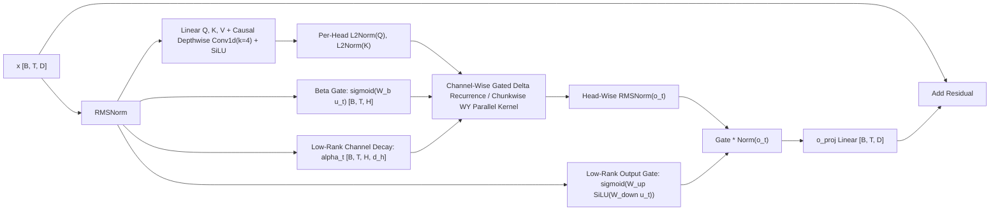

# HNDL Operator, SOTA Architecture, & Test Recipe Gap Audit

- **Date:** 2026-10-17
- **Project:** HNDL (*Human-readable Network Definition Language*)
- **Version Audited:** `0.8.2` (branch `develop`, commit `d3a76f9`)
- **Design Mandate:** **Robust** (static bidirectional shape contracts, zero-execution config safety, deterministic plans), **Accurate** (independent mathematical `reference=` oracles, `float64` gradcheck parity, bounded spectral norms), and **Fast** (fused ATen/CUDA/Triton kernels, zero-graph-break `torch.compile`, C-speed runtime verification).

---

## 1. Executive Summary

HNDL `0.8.2` ships **69 built-in operators** across **12 categories**, backed by a monotone bidirectional constraint solver ([`src/hndl/resolver.py`](file:///home/martyn/dev/hndl/src/hndl/resolver.py)), a zero-execution AST config parser ([`src/hndl/_parser.py`](file:///home/martyn/dev/hndl/src/hndl/_parser.py)), a slot-recycled C-verified PyTorch runtime ([`src/hndl/torch.py`](file:///home/martyn/dev/hndl/src/hndl/torch.py)), and 100% mathematical `reference=` oracle coverage across all 68 non-pretrained built-in operators ([`src/hndl/testing.py`](file:///home/martyn/dev/hndl/src/hndl/testing.py)).

Auditing the codebase against **2024–2026 SOTA model architectures** reveals three core conclusions:

1. **Many modern SOTA sub-architectures can already be expressed in HNDL today, but are completely absent from `examples/networks/` and integration recipes.**
   - All 13 authored networks in [`examples/networks/`](file:///home/martyn/dev/hndl/examples/networks/) are **2015–2020 baselines** (`mlp`, `autoencoder`, `lenet5`, `resnet18`, `unet_small`, `dcgan_generator`, `dcgan_discriminator`, `conditional_discriminator`, `sagan_attention`, `vit_tiny`, `gpt_tiny`, `moe_transformer`, `hopfield_classifier`).
   - **29 of the 69 built-in operators (42%) never appear in any network in `examples/networks/`**—including modern workhorses that HNDL already ships and optimizes: [`rms_norm`](file:///home/martyn/dev/hndl/src/hndl/operators/rms_norm.py), [`swiglu`](file:///home/martyn/dev/hndl/src/hndl/operators/swiglu.py), [`cross_attention`](file:///home/martyn/dev/hndl/src/hndl/operators/cross_attention.py), [`conv1d`](file:///home/martyn/dev/hndl/src/hndl/operators/conv1d.py), [`group_norm`](file:///home/martyn/dev/hndl/src/hndl/operators/group_norm.py), [`instance_norm`](file:///home/martyn/dev/hndl/src/hndl/operators/instance_norm.py), [`adaptive_norm`](file:///home/martyn/dev/hndl/src/hndl/operators/adaptive_norm.py), [`pixel_shuffle`](file:///home/martyn/dev/hndl/src/hndl/operators/pixel_shuffle.py), [`learned_scale`](file:///home/martyn/dev/hndl/src/hndl/operators/learned_scale.py), [`coordinate_grid`](file:///home/martyn/dev/hndl/src/hndl/operators/coordinate_grid.py), [`fourier_features`](file:///home/martyn/dev/hndl/src/hndl/operators/fourier_features.py), and [`grid_sample`](file:///home/martyn/dev/hndl/src/hndl/operators/grid_sample.py).
2. **Existing sequence/attention/MoE operators have narrow parameterization gaps that block exact SOTA configurations (Llama 3/4, Qwen3, Gemma 2/3, DeepSeek-V3, Flux/DiT).**
   - [`attention`](file:///home/martyn/dev/hndl/src/hndl/operators/attention.py) lacks **Grouped-Query Attention (`kv_heads`)**, **QK-Norm (`qk_norm`)**, **configurable `rope_theta`** (hardcoded to `10000.0`), **independent `head_dim`**, **sliding-window attention (`window_size`)**, and **logit soft-capping**.
   - [`moe`](file:///home/martyn/dev/hndl/src/hndl/operators/moe.py) hardcodes **2-layer biased MLP experts** (`down(act(up(x)))`) and **top-$k$ softmax routing**, lacking **SwiGLU experts**, **bias-free experts**, **sigmoid affinity routing**, and **batched/grouped GEMM execution**.
   - [`transformer_block`](file:///home/martyn/dev/hndl/src/hndl/operators/transformer_block.py) hardcodes `rope=False`, `bias=True`, and a 2-layer `FeedForward` (no `swiglu`, no `kv_heads`, no `qk_norm`).
   - [`adaptive_norm`](file:///home/martyn/dev/hndl/src/hndl/operators/adaptive_norm.py) is restricted to rank-4 `[B, C, H, W]` images, leaving rank-3 `[B, T, D]` Diffusion Transformers (DiT / MMDiT **AdaLN-Zero**) without adaptive sequence modulation.
   - [`conv1d`](file:///home/martyn/dev/hndl/src/hndl/operators/conv1d.py) has symmetric padding only (`causal=False`) and requires `[B, C, L]` layout, forcing 3 extra nodes (`transpose` $\to$ `pad` $\to$ `conv1d` $\to$ `transpose`) for every causal short convolution in modern sequence models.
3. **Sub-quadratic / Recurrent SOTA Layers like Kimi Delta Attention (KDA), Gated DeltaNet, Mamba-2, and Multi-Head Latent Attention (MLA) cannot be composed from existing HNDL primitives—and `pretrained` is only a partial escape hatch.**
   - Because HNDL enforces **acyclic DAGs** ([`resolver.py:127-159`](file:///home/martyn/dev/hndl/src/hndl/resolver.py#L127-L159)) and **ranks 2–4 only** (`SUPPORTED_RANKS = (2, 3, 4)` in [`operator.py:36`](file:///home/martyn/dev/hndl/src/hndl/operator.py#L36)), intra-sequence state recurrences over matrix states $\mathbf{S}_{t,h} \in \mathbb{R}^{d_k \times d_v}$ must be encapsulated *inside* an `@operator`.
   - Using [`pretrained`](file:///home/martyn/dev/hndl/src/hndl/operators/pretrained.py) for blocks like KDA works for **frozen or fine-tuned pre-saved checkpoints**, but fails as a general layer mechanism because: (a) [`_traced_output_shapes`](file:///home/martyn/dev/hndl/src/hndl/pretrained.py#L700-L726) traces models on `torch.device("meta")`, which crashes custom Triton/CUDA kernels (`fla`, `mamba_ssm`, `flash_mla`) that lack fake-tensor registrations; (b) `LocalProvider` requires a pre-existing `.pth` file and 64-char `sha256` on disk (cannot instantiate untrained layers from scratch); and (c) `TransformersProvider` only accepts rank-2 `int64` token IDs at the graph root, not rank-3 `[B, T, D]` hidden states mid-network.

---

## 2. SOTA Architecture Coverage Matrix (`v0.8.2`)

| SOTA Model Family | Representative Models | Support Status in `v0.8.2` | What Works Today | Blocking Gaps in Existing Catalog |
| :--- | :--- | :---: | :--- | :--- |
| **Classic CNNs, GANs, & Post-Norm / Basic Pre-Norm Transformers** | LeNet-5, ResNet-18/34, U-Net, DCGAN, SAGAN, ViT (2020), GPT-2 | **Full (Native)** | `conv`, `deconv`, `resblock`, `batch_norm`, `patch_embed`, `cls_token`, `pos_embed`, `transformer_block`, `spatial_attention` | ResNet-50+ requires 1×1$\to$3×3$\to$1×1 bottleneck option in `resblock`. |
| **Dense Frontier Decoder LLMs** | Llama 2, Mistral-7B v0.1 (MHA variants) | **Partial (Manual Composition)** | `embedding`, `rms_norm`, `attention(causal=True, rope=True, bias=False)`, `swiglu(bias=False)` | **GQA/MQA (`kv_heads`)** missing for Llama 3/4, Qwen2.5/3, Mistral; `rope_theta` fixed at `10000.0`; `transformer_block` lacks `rope`/`swiglu`/`bias=False`. |
| **Next-Gen Dense LLMs with QK-Norm, Softcap, & Local/Global Attention** | Qwen3, Gemma 2, Gemma 3, Llama 4 | **Blocked on Attention Options** | `rms_norm`, `swiglu`, `attention` | Missing **QK-Norm** (`qk_norm="rms_norm"`), **zero-centered RMSNorm** (`1 + w` for Gemma), **independent `head_dim`**, **sliding-window attention (`window_size`)**, and **logit soft-capping**. |
| **Frontier Sparse MoE LLMs** | Mixtral 8x7B, Qwen2.5-MoE, Qwen3-MoE, DeepSeek-V2/V3/R1, Kimi K2 | **Partial (Toy MoE Only)** | `moe(experts, hidden, top_k, activation="silu")`, parallel shared expert via `add(swiglu(h, ...), moe(h, ...))` | `moe` experts are **2-layer biased MLPs** instead of **3-layer bias-free SwiGLU experts**; router lacks **sigmoid affinity scoring** and **aux-loss-free load-balancing bias**; eager dispatch loops in Python over experts. |
| **Latent-KV Compressed Attention** | DeepSeek-V2/V3/R1, Kimi Linear (MLA layers) | **Unsupported** | None (cannot compose decoupled RoPE + low-rank joint KV latent with rank-3 `matmul`) | Needs a dedicated **`latent_attention` (`mla`)** operator with `kv_lora_rank`, optional `q_lora_rank`, and decoupled `rope_head_dim` (plus `rope=False` NoPE mode). |
| **Linear / Delta Attention & State-Space Models (SSMs)** | **Kimi Linear (KDA)**, Gated DeltaNet, Mamba-2 (SSD), RWKV-7 | **Unsupported** | Outer pre-`rms_norm`, `swiglu`, and `transpose`+`pad`+`conv1d(groups=D)` | Needs **`gated_delta_attention` (`kda`)** and **`l2_norm`** (plus `conv1d(..., causal=True, channels_last=True)`). |
| **Diffusion & Flow-Matching Transformers** | DiT, SiT, SD3, Flux.1 (MMDiT) | **Partial** | `patch_embed`, `attention`, `swiglu`, dual-stream `concat`/`split` | `adaptive_norm` only accepts rank-4 `[B, C, H, W]`; missing rank-3 **`adaln_zero`** (`[B, T, D]` modulated by `cond[B, D_c]`), **`sinusoidal_embed`**, and QK-Norm in `attention`. |
| **Modern Vision Backbones** | DINOv2, CaiT, ConvNeXt-V2, Swin / RPB-ViT, SigLIP | **Mostly Supported** | `transformer_block(layer_scale=True)`, `attention(relative_position_bias=True, spatial_shape=...)`, `conv(groups=C)`, `cross_attention` | ConvNeXt-V2 needs **Global Response Normalization (`grn`)**; DINOv2 needs `swiglu` option in `transformer_block`; SigLIP/CLIP contrastive heads need **`l2_norm`**. |
| **Audio, Speech, & Neural Codecs** | Whisper, EnCodec, Vocos, WaveNet | **Partial** | `conv1d(dilation=..., groups=..., spectral_norm=...)`, `cross_attention`, `transformer_block` | Missing **1D transposed convolution (`deconv1d`)** for waveform upsampling and **`causal=True`** on `conv1d`. |

---

## 3. Deep Dive: Kimi Delta Attention (KDA) & The Role of `pretrained`

### 3.1 How Kimi Delta Attention (KDA / Kimi Linear) Works

Introduced in *Kimi Linear: An Expressive, Efficient Attention Architecture* (Moonshot AI, arXiv:2510.26692), **Kimi Delta Attention (KDA)** is a hardware-efficient linear attention mechanism that interleaves **3 KDA layers for every 1 Multi-Head Latent Attention (MLA) layer (3:1 ratio)**, where the MLA layers use **NoPE (No Positional Embeddings)** because KDA carries recency and position natively.

For an input sequence $\mathbf{x} \in \mathbb{R}^{B \times T \times D}$ with $H$ heads and head dimension $d_h = D / H$ (typically $d_h = 128$), a KDA block computes:



1. **Short Causal Depthwise Convolution (`kernel_size=4`) + `SiLU`** on $Q, K, V$ projections:
   $$\tilde{\mathbf{q}}_t = \text{SiLU}(\text{CausalConv1d}_{k=4}(W_q \mathbf{u})_t), \quad \tilde{\mathbf{k}}_t = \text{SiLU}(\text{CausalConv1d}_{k=4}(W_k \mathbf{u})_t), \quad \mathbf{v}_t = \text{SiLU}(\text{CausalConv1d}_{k=4}(W_v \mathbf{u})_t)$$
2. **Per-Head $\text{L}_2$ Normalization on Queries and Keys**:
   $$\mathbf{q}_{t,h} = \frac{\tilde{\mathbf{q}}_{t,h}}{\|\tilde{\mathbf{q}}_{t,h}\|_2 + \epsilon}, \quad \mathbf{k}_{t,h} = \frac{\tilde{\mathbf{k}}_{t,h}}{\|\tilde{\mathbf{k}}_{t,h}\|_2 + \epsilon}$$
   Bounding $\|\mathbf{k}_{t,h}\|_2 = 1$ guarantees that the Householder-like erasure factor $\mathbf{I} - \beta_{t,h} \mathbf{k}_{t,h} \mathbf{k}_{t,h}^\top$ has eigenvalues in $[1 - \beta_{t,h}, 1]$, preventing numerical explosion over long contexts.
3. **Fine-Grained Channel-Wise Decay Gate ($\boldsymbol{\alpha}_{t,h} \in (0, 1)^{d_h}$) & Writing Strength ($\beta_{t,h} \in (0, 1)$)**:
   - Unlike Mamba-2 or Gated DeltaNet (which use a single scalar decay per head), KDA parameterizes a per-channel decay vector $\boldsymbol{\alpha}_{t,h} = \exp(-\exp(\mathbf{A}_{\text{log}}) \odot \text{softplus}(W_{\uparrow \alpha} \text{SiLU}(W_{\downarrow \alpha} \mathbf{u}_t) + \mathbf{b}_\alpha))$ via a low-rank bottleneck ($D \to r \to H d_h$), alongside per-head writing strength $\beta_{t,h} = \sigma(W_\beta \mathbf{u}_t)_h$.
4. **Channel-Wise Gated Delta Rule Recurrence**:
   Each head updates its associative memory matrix $\mathbf{S}_{t,h} \in \mathbb{R}^{d_h \times d_h}$ ($\mathbf{S}_{0,h} = \mathbf{0}$) by decaying each key channel and applying a rank-1 delta-rule error correction:
   $$\widetilde{\mathbf{S}}_{t,h} = \text{Diag}(\boldsymbol{\alpha}_{t,h}) \mathbf{S}_{t-1,h}, \qquad \mathbf{S}_{t,h} = \widetilde{\mathbf{S}}_{t,h} + \beta_{t,h} \mathbf{k}_{t,h} \!\left(\mathbf{v}_{t,h} - \widetilde{\mathbf{S}}_{t,h}^\top \mathbf{k}_{t,h}\right)^\top, \qquad \mathbf{o}_{t,h} = \mathbf{S}_{t,h}^\top \mathbf{q}_{t,h}$$
5. **Hardware-Efficient Chunkwise Parallel Algorithm (Specialized DPLR / WY Representation)**:
   Because the transition matrix $\mathbf{T}_{t,h} = \text{Diag}(\boldsymbol{\alpha}_{t,h}) - (\beta_{t,h} \mathbf{k}_{t,h})(\boldsymbol{\alpha}_{t,h} \odot \mathbf{k}_{t,h})^\top$ is Diagonal-Plus-Rank-1 sharing $\mathbf{k}_{t,h}$, sequence chunks of length $C=64$ are evaluated entirely via matrix multiplications (Tensor Core GEMMs) during training and prefill, while matching the $O(d_h^2)$-state sequential recurrence to floating-point precision.
6. **Head-Wise `RMSNorm` + Sigmoid Output Gate + `o_proj`**:
   $$\mathbf{y}_t = \mathbf{x}_t + W_o \!\left(\sigma(W_{\uparrow g} \text{SiLU}(W_{\downarrow g} \mathbf{u}_t)) \odot \text{RMSNorm}_h(\mathbf{o}_t)\right)$$

### 3.2 Can We Use `pretrained` for Kimi Delta Attention?

The short answer is: **`pretrained` can wrap a saved checkpoint containing KDA (with caveats), but it is NOT a viable substitute for a native or host-registered `@operator` when building, testing, or training architectures in HNDL.**

#### How `pretrained` (`src/hndl/pretrained.py`) Behaves on KDA / Mamba-2 / FlashMLA

| Mechanism | How It Works Today | Why It Breaks or Hurts on KDA / Novel Layers |
| :--- | :--- | :--- |
| **1. Meta-Device Shape Tracing**<br>([`pretrained.py:700-726`](file:///home/martyn/dev/hndl/src/hndl/pretrained.py#L700-L726)) | `pretrained` has no declarative output shape argument; `_traced_output_shapes` instantiates the model and runs `model(probe)` inside `with torch.device("meta"):`. | **Hard Blocker for Custom Kernels:** KDA (`fla` Triton kernels), Mamba-2 (`mamba_ssm` CUDA selective scan), and FlashMLA inspect `tensor.is_cuda`, `tensor.data_ptr()`, or launch Triton JIT kernels that raise `NotImplementedError` / `RuntimeError` on `meta` tensors unless the upstream library registered `@torch.library.register_fake` kernels for every op. |
| **2. Mandatory Checkpoint File + SHA-256**<br>([`pretrained.py:271-291, 629-642`](file:///home/martyn/dev/hndl/src/hndl/pretrained.py#L271-L291)) | `LocalProvider` (`provider="..."`) requires a real `.pth`/`.pt` file on disk and a 64-character hex `sha256="..."`, verifying `load_state_dict(strict=True)`. | **Cannot Build Scratch Networks:** You cannot write `pretrained(provider="kda_block")` to construct a randomly initialized KDA layer for training or unit testing without first serializing a dummy `.pth` checkpoint to disk and hardcoding its SHA-256 hash into the `.hndl` recipe. |
| **3. `TransformersProvider` Input Contract & `trust_remote_code`**<br>([`pretrained.py:357, 367-373`](file:///home/martyn/dev/hndl/src/hndl/pretrained.py#L357-L373)) | `TransformersProvider` calls `AutoConfig`/`AutoModel` without `trust_remote_code=True`, and hardcodes `Contract("ids")` (rank-2 `int64` `input_ids`) for all non-vision models. | **Cannot Wrap Mid-Network Sequence Blocks:** A Hugging Face checkpoint cannot be placed mid-graph on a rank-3 `[B, T, D]` floating-point stream (`operators/pretrained.py:24` rejects float inputs on `"ids"` contracts with `E_DTYPE`), and models requiring custom HF code (like `MoonshotAI/Kimi-Linear`) fail in `AutoConfig`. |
| **4. Unidirectional Shape Solving**<br>([`operators/pretrained.py:38-40`](file:///home/martyn/dev/hndl/src/hndl/operators/pretrained.py#L38-L40)) | `_relation` waits until `x[1:]` is 100% resolved before tracing (`if x is None or any(v is None for v in x[1:]): return`). | **Loses Bidirectional Solver Power:** Unlike native operators (`x[B, T, D] -> out[B, T, D]`), `pretrained` cannot propagate `D` backward from a downstream layer or infer inner dimensions. |
| **5. No `reference=` Oracle** | `pretrained` is the only operator exempt from `check_reference` in [`testing.py`](file:///home/martyn/dev/hndl/src/hndl/testing.py). | **Reduces Verification Accuracy:** Wrapping KDA in `pretrained` bypasses HNDL's dual-implementation verification (`forward` chunkwise parallel vs. `_reference` sequential recurrence). |

#### The Right 3-Tier Strategy for Novel Blocks in HNDL

1. **First-Class Built-in `@operator` (`gated_delta_attention` / `kda`) — Best for Robustness, Accuracy, & Speed:**
   - Declares `shape="x[B, T, D] -> out[B, T, D]"` so shape resolution is instantaneous ($0\text{ ms}$, zero meta-device tracing, full bidirectional `D` and `T` inference).
   - Implements the **chunkwise parallel WY/DPLR algorithm** in `forward()` using pure batched PyTorch Tensor Core GEMMs (`torch.matmul`, `torch.linalg.solve_triangular` on fixed chunks $C=64$)—which is 100% `torch.compile(fullgraph=True)` compatible on CPU and CUDA without external Triton/C++ build dependencies—and optionally dispatches to `fla` Triton kernels when installed.
   - Implements the textbook **step-by-step recurrence** $\mathbf{S}_t = (\mathbf{I} - \beta_t \mathbf{k}_t \mathbf{k}_t^\top)\text{Diag}(\boldsymbol{\alpha}_t)\mathbf{S}_{t-1} + \beta_t \mathbf{k}_t \mathbf{v}_t^\top$ in `_reference(module)`, giving HNDL automatic `float64` forward/backward parity tests via `hndl.testing.check_operator`!
2. **Host-Registered `@registry.operator` — Best for Experimental / External Library Layers:**
   - HNDL `0.8.0` already made `Registry.operator`, `hndl.relations`, and `hndl.testing.check_operator` public! A host application wrapping an external kernel (e.g. `mamba_ssm` or `flash_mla`) should register a custom `@registry.operator` with declarative `shape="x[B, T, D] -> out[B, T, D]"` rather than abusing `pretrained`.
3. **Hardening `pretrained` for True Pretrained Checkpoints:**
   - Add an optional `output_shape` (or provider-declared `contract` callback on `registry.pretrained_provider(name, build, shape_fn=...)`) so `LocalProvider` can resolve shapes even when the wrapped module contains meta-incompatible custom CUDA/Triton kernels.
   - Allow `LocalProvider` contracts to accept `int64` token IDs when specified by the provider.

---

## 4. Operator Gap Analysis & Recommended Layer Additions

To keep HNDL **robust, accurate, and fast** while minimizing catalog bloat, we separate recommendations into:
- **Part 4.1: Backward-Compatible Extensions to Existing Operators** (using `Arg(..., since="0.9.0")` so all existing plans and `semantic_digest` hashes remain 100% unchanged).
- **Part 4.2: New Built-in Operators** (Tier 1 high-priority SOTA primitives and Tier 2 domain-completing primitives).

### 4.1 High-Leverage Extensions to Existing Operators (`Arg(..., since="0.9.0")`)

#### 1. [`attention`](file:///home/martyn/dev/hndl/src/hndl/operators/attention.py) & [`cross_attention`](file:///home/martyn/dev/hndl/src/hndl/operators/cross_attention.py) — Unlocking Llama 3/4, Qwen3, Gemma 2/3, & Mistral
| Proposed `Arg` (`since="0.9.0"`) | Type & Default | Robustness (Solver / Validation) | Accuracy & Speed (Lowering) |
| :--- | :--- | :--- | :--- |
| **`kv_heads`** | `Arg(int, 0, min=0, positional=False)` (`0` $\Rightarrow$ `heads`) | Enforces `heads % kv_heads == 0` (`E_CONSTRAINT`). `k_proj` and `v_proj` project to `kv_heads * head_dim`. | Passes `enable_gqa=(kv_heads != heads)` directly to `F.scaled_dot_product_attention` (native fused FlashAttention-2/cuDNN GQA in PyTorch $\ge 2.5$). |
| **`head_dim`** | `Arg(int, 0, min=0, positional=False)` (`0` $\Rightarrow$ `D // heads`) | When `head_dim == 0`, enforces `D % heads == 0`; when `head_dim > 0`, allows decoupled inner width `heads * head_dim != D` (Gemma 2/3, Qwen3). | `q_proj` is `Linear(D, heads * head_dim)`, `o_proj` is `Linear(heads * head_dim, D)`. |
| **`qk_norm`** | `Arg(str, "none", choices=("none", "rms_norm", "l2_norm"))` | If `"rms_norm"`, registers `q_norm` and `k_norm` (`RMSNorm(head_dim, eps=eps)`). | Applies fused `F.rms_norm` or `F.normalize` per head before RoPE/SDPA. Critical for Qwen3, Gemma 3, ViT-22B, Flux/SD3. |
| **`rope_theta`** | `Arg(float, 10000.0, min=1.0, exclusive_min=True)` | Rejects `rope_theta != 10000.0` when `rope=False` (`E_ARGUMENT`). | Replaces hardcoded `ROPE_BASE = 10000.0` in `_rope_tables` (supports `500000.0` for Llama 3, `1000000.0` for Qwen2.5/3). |
| **`window_size`** | `Arg(int, 0, min=0, positional=False)` (`0` $\Rightarrow$ full context) | Enforces `window_size >= 1` when set; combines with `causal` mask. | Bands attention mask to $|i - j| < W$ (or $0 \le i - j < W$ when `causal=True`). |
| **`logit_softcap`** | `Arg(float, 0.0, min=0.0, positional=False)` | `0.0` disables soft-capping. | Applies `cap * torch.tanh(scores / cap)` before softmax (Gemma 2 / Grok). |

#### 2. [`moe`](file:///home/martyn/dev/hndl/src/hndl/operators/moe.py) — Unlocking Mixtral, Qwen-MoE, DeepSeek-V3, & Kimi-K2
- **`expert_kind: Arg(str, "mlp", choices=("mlp", "swiglu"), positional=False, since="0.9.0")`**: Allows each expert in `self.experts` to be a 3-projection `SwiGLU(D, hidden, bias=bias)` instead of only a 2-layer `Expert(D, hidden, activation)`.
- **`bias: Arg(bool, True, positional=False, since="0.9.0")`**: Defaults to `True` for backward compatibility, while allowing `bias=False` for modern SwiGLU MoEs.
- **`scoring: Arg(str, "softmax", choices=("softmax", "sigmoid"), positional=False, since="0.9.0")`**: Supports DeepSeek-V3 / Kimi-K2 `sigmoid` affinity routing (`weights = scores / scores.sum(dim=-1, keepdim=True)` over top-$k$ selected experts).
- **Speed Optimization**: Stack expert weights or dispatch via `torch._grouped_mm` (on CUDA `bfloat16`/`float16` when available) while keeping the existing `experts.<i>.*` `state_dict` parameter views or hook-verified layout.

#### 3. [`transformer_block`](file:///home/martyn/dev/hndl/src/hndl/operators/transformer_block.py) — First-Class Modern Decoder & ViT Block
- Add `ffn_kind: Arg(str, "mlp", choices=("mlp", "swiglu"), since="0.9.0")`, `hidden: Arg(int, 0, min=0, since="0.9.0")` (overrides `mlp_ratio * D` so non-integer multipliers like $\frac{8}{3}D$ can be specified exactly), `rope: Arg(bool, False, since="0.9.0")`, `rope_theta: Arg(float, 10000.0, since="0.9.0")`, `kv_heads: Arg(int, 0, since="0.9.0")`, `qk_norm: Arg(str, "none", since="0.9.0")`, and `bias: Arg(bool, True, since="0.9.0")`.
- This turns a 9-line manual LLaMA/Qwen block loop into a single readable statement:
  ```python
  transformer_block(32, kv_heads=8, hidden=14336, ffn_kind="swiglu", norm="rms_norm", causal=True, rope=True, bias=False)
  ```

#### 4. [`conv1d`](file:///home/martyn/dev/hndl/src/hndl/operators/conv1d.py) — First-Class Causal & Sequence-Layout 1D Convolution
- **`causal: Arg(bool, False, positional=False, since="0.9.0")`**:
  - When `causal=True` (requires `padding == 0`), left-pads the length axis by `left_pad = dilation * (kernel_size - 1)` using `F.pad(x, (left_pad, 0))` before `F.conv1d(..., padding=0)`.
  - **Solver Benefit**: When `causal=True` and `stride == 1`, `L_out == L_in` is an **exact bijection** in both forward and backward solver sweeps (no ambiguous inverse interval!).
- **`channels_last: Arg(bool, False, positional=False, since="0.9.0")`**:
  - Accepts `x[B, T, C_in] -> out[B, T, C_out]` directly, performing the contiguous transpose internally so sequence models (`[B, T, D]`) do not need two explicit `transpose(1, 2)` graph nodes around every `conv1d`.

#### 5. [`rms_norm`](file:///home/martyn/dev/hndl/src/hndl/operators/rms_norm.py), [`layer_norm`](file:///home/martyn/dev/hndl/src/hndl/operators/layer_norm.py), [`adaptive_norm`](file:///home/martyn/dev/hndl/src/hndl/operators/adaptive_norm.py), & [`matmul`](file:///home/martyn/dev/hndl/src/hndl/operators/matmul.py)
- **`rms_norm`**: Add `zero_centered: Arg(bool, False, positional=False, since="0.9.0")` where `weight` is initialized to `0.0` and applied as `F.rms_norm(x, (D,), None, eps) * (1.0 + self.weight)` (used across Gemma 1/2/3).
- **`layer_norm`**: Add `bias: Arg(bool, True, positional=False, since="0.9.0")` passed to `nn.LayerNorm(..., bias=bias and affine)`.
- **`adaptive_norm`**: Allow both rank-3 `x[B, T, C], params[B, 2*C] -> out[B, T, C]` (normalizing axis `-1` via `F.layer_norm(x, (C,), eps=eps)`) and rank-4 `x[B, C, H, W], params[B, 2*C] -> out[B, C, H, W]`.
- **`matmul`**: Generalize shape from `"a[B, N, K], b[B, K, M] -> out[B, N, M]"` to `"a[B, ..., N, K], b[B, ..., K, M] -> out[B, ..., N, M]"` so both rank-3 (`[B, N, K]`) and rank-4 multi-head (`[B, H, N, K]`) batched matrix multiplications are supported.

---

### 4.2 New Layers / Operators to Consider Adding

#### Tier 1: High-Priority SOTA Primitives

##### 1. `gated_delta_attention` (Alias: `gated_delta_attention`, Identity: `gated_delta_attention@1`)
- **Purpose:** Native support for **Kimi Delta Attention (KDA)** (`decay_kind="channel"`, low-rank channel-wise decay) and **Gated DeltaNet** (`decay_kind="head"`, scalar head-wise decay).
- **Shape & Category:** `shape="x[B, T, D] -> out[B, T, D]"`, `category="sequence"`.
- **Arguments:**
  - `heads: Arg(int, min=1)` (must divide `D` when `head_dim == 0`)
  - `head_dim: Arg(int, 0, min=0, positional=False)` (`0` $\Rightarrow$ `D // heads`)
  - `decay_kind: Arg(str, "channel", choices=("channel", "head"), positional=False)` (`"channel"` = Kimi KDA; `"head"` = Gated DeltaNet)
  - `gate_rank: Arg(int, 0, min=0, positional=False)` (`0` $\Rightarrow$ `max(head_dim, D // 16)` low-rank bottleneck for channel decay and output gate)
  - `conv_size: Arg(int, 4, min=0, max=16, positional=False)` (`0` disables causal short depthwise conv1d on Q/K/V)
  - `chunk_size: Arg(int, 64, min=1, max=512, positional=False)` (chunk size for parallel WY/DPLR Tensor Core evaluation)
  - `eps: Arg(float, 1e-6, min=0, exclusive_min=True, positional=False)`
- **Why It Excels on Robustness, Accuracy, & Speed:**
  - **Robust**: Enforces `D % heads == 0` (when `head_dim == 0`), validates positive dimensions, and maintains zero mutable buffers during `forward`.
  - **Accurate**: `_reference(module)` runs the exact step-by-step recurrence over $t = 0 \dots T-1$ in `float64`/`float32`, while `forward()` runs the chunkwise parallel WY representation. `hndl.testing.check_operator` automatically proves that the parallel chunk algorithm and sequential recurrence produce identical outputs and gradients!
  - **Fast**: Intra-chunk transitions use batched matrix multiplications (`torch.matmul`) and `torch.linalg.solve_triangular` on `[B, H, T // C, C, C]` blocks with 0 graph breaks under `torch.compile(fullgraph=True)`.

##### 2. `latent_attention` (Multi-Head Latent Attention / MLA, Identity: `latent_attention@1`)
- **Purpose:** Native support for **DeepSeek-V2/V3/R1** and **Kimi Linear** global MLA layers (including both decoupled-RoPE MLA and NoPE MLA).
- **Shape & Category:** `shape="x[B, T, D] -> out[B, T, D]"`, `category="sequence"`.
- **Arguments:**
  - `heads: Arg(int, min=1)`
  - `kv_lora_rank: Arg(int, min=1)` (compressed KV latent width $d_c$, e.g. `512` or `D // 4`)
  - `q_lora_rank: Arg(int, 0, min=0, positional=False)` (`0` $\Rightarrow$ direct $W_Q$; $>0$ $\Rightarrow$ low-rank $Q$ bottleneck)
  - `qk_nope_head_dim: Arg(int, 0, min=0, positional=False)` (`0` $\Rightarrow$ `D // heads`)
  - `qk_rope_head_dim: Arg(int, 0, min=0, positional=False)` (`0` $\Rightarrow$ NoPE mode used in Kimi Linear; $>0$ $\Rightarrow$ decoupled RoPE key/query heads used in DeepSeek-V2/V3, must be even)
  - `v_head_dim: Arg(int, 0, min=0, positional=False)` (`0` $\Rightarrow$ `qk_nope_head_dim`)
  - `causal: Arg(bool, True, positional=False)`
  - `rope_theta: Arg(float, 10000.0, min=1.0, exclusive_min=True, positional=False)`
- **Fast Lowering:** Down-projects $c_t^{KV} = \text{RMSNorm}(W^{DKV} x_t) \in \mathbb{R}^{B \times T \times d_c}$, up-projects $K^C, V^C$, optionally concatenates RoPE-rotated $q^R, k^R$, and dispatches to `F.scaled_dot_product_attention`.

##### 3. `l2_norm` (Identity: `l2_norm@1`)
- **Purpose:** Parameter-free $\text{L}_2$ normalization (`F.normalize(x, p=2, dim=dim, eps=eps)` or RMS-scaled unit norm). Required by KDA, QK-L2-Norm, cosine classifiers, andCLIP/SigLIP dual-encoder towers.
- **Shape & Category:** `shape="x[B, ...] -> out[B, ...]"`, `category="normalization"`.
- **Arguments:** `dim: Arg(int, -1)`, `eps: Arg(float, 1e-6, min=0, exclusive_min=True, positional=False)`.

##### 4. `adaln_zero` (Adaptive LayerNorm-Zero Modulation, Identity: `adaln_zero@1`)
- **Purpose:** Standard conditioning primitive for **Diffusion Transformers (DiT, SiT, SD3, Flux.1)**. Projects a conditioning vector `cond[B, D_cond]` via a zero-initialized linear layer (`SiLU(cond) -> Linear(D_cond, 3*D, init=0)`) into `(shift, scale, gate)`, returning modulated normalized tokens `(1 + scale[:, None, :]) * LayerNorm(x, affine=False) + shift[:, None, :]` and a residual gate `gate[:, None, :]` (or applying the gated residual directly around a branch).
- **Shape & Category:** `shape="x[B, T, D], branch[B, T, D], cond[B, D_cond] -> out[B, T, D]"` (or two-output `normed, gate = adaln_zero(x, cond)`), `category="normalization"`.

##### 5. `rope` (Standalone Rotary Position Embedding, Identity: `rope@1`)
- **Purpose:** Allows applying 1D (or 2D axial) rotary embeddings to any `[B, T, D]` sequence outside of `attention`, enabling custom attention graphs in `.hndl`.
- **Shape & Category:** `shape="x[B, T, D] -> out[B, T, D]"`, `category="sequence"`.
- **Arguments:** `heads: Arg(int, 1, min=1, positional=False)`, `theta: Arg(float, 10000.0, min=1.0, exclusive_min=True, positional=False)`.

#### Tier 2: Domain-Completing Primitives (Audio, Vision, Conditioning)

| Operator | Shape Contract | Category | Key Use Case |
| :--- | :--- | :--- | :--- |
| **`deconv1d`** (`conv_transpose1d@1`) | `x[B, C_in, L_in] -> out[B, C_out, L_out]` | `convolution` | 1D audio/waveform synthesis and neural codecs (EnCodec, HiFi-GAN, DAC); reuses `conv_transpose_axis` already in [`hndl/relations.py`](file:///home/martyn/dev/hndl/src/hndl/relations.py#L180-L195) and supports `policy="up2"`. |
| **`grn`** (`grn@1`) | `x[B, C, H, W] -> out[B, C, H, W]` | `normalization` | **Global Response Normalization** for **ConvNeXt-V2**: computes spatial $\text{L}_2$ norm $g = \|x\|_{2, HW}$, normalizes across channels $n = g / (\text{mean}_C(g) + \epsilon)$, and returns $\gamma (x \odot n) + \beta + x$. |
| **`sinusoidal_embed`** (`sinusoidal_embed@1`) | `x[B, D_in] -> out[B, D_out]` | `sequence` | Deterministic log-spaced sinusoidal timestep/coordinate embedding (used in every Diffusion U-Net and DiT timestep conditioning MLP). |
| **`cast`** (`cast@1`) | `x[B, ...]:any -> out[B, ...]` | `core` | Explicit dtype conversion (`to_dtype="compute"` or `"int64"` / `"bool"`) for embeddings/masks in multi-input graphs. |

---

## 5. Audit of Test Recipes & Concrete Additions for `examples/networks/` and `tests/`

### 5.1 Current Gap in `examples/networks/` (`tests/test_network_examples.py`)

Currently, [`tests/test_network_examples.py`](file:///home/martyn/dev/hndl/tests/test_network_examples.py) and [`tests/benchmark/test_example_networks_latency.py`](file:///home/martyn/dev/hndl/tests/benchmark/test_example_networks_latency.py) only run the 13 networks in `examples/networks/`. Auditing operator usage across all 13 `.hndl` files shows that **only 40 of the 69 built-in operators are ever instantiated in `examples/networks/`**.

The **29 built-in operators with 0 occurrences in `examples/networks/`** are:
- **Sequence & Attention (6):** `swiglu`, `cross_attention`, `gather_token`, `fourier_features`, `rms_norm` *(norm)*, `learned_scale` *(arithmetic)*
- **Convolution & Spatial (7):** `conv1d`, `adaptive_avg_pool`, `pixel_shuffle`, `coordinate_grid`, `grid_sample`, `group_norm` *(norm)*, `instance_norm` *(norm)*
- **Arithmetic & Shape (8):** `sub`, `mul`, `broadcast_add`, `broadcast_mul`, `matmul`, `scale`, `clamp`, `constant`, `chunk`, `pad`, `permute`, `mean`, `sum`, `transpose`
- **Activations & Pretrained (5):** `elu`, `hardswish`, `mish`, `quick_gelu`, `softplus`, `identity`, `softmax`, `pretrained`

### 5.2 Ready-to-Add SOTA Network Recipes (Work Today in `v0.8.2` with Zero Code Changes)

The following **5 SOTA network recipes** resolve, build, run forward/backward, and round-trip today using existing `v0.8.2` operators, and immediately close the coverage gap for `rms_norm`, `swiglu`, `attention(rope=True, bias=False)`, `cross_attention`, `conv1d`, `group_norm`, `learned_scale`, and `pixel_shuffle`:

#### Recipe 1: `llama_tiny.hndl` — Modern Pre-RMSNorm + RoPE + SwiGLU Causal LLM
- **Contract:** `input_shape=["B", 64]` (`int64`) $\to$ `output_shape=["B", 64, 256]`
- **Verified Profile:** `27 nodes`, `918,656 parameters`
- **Operators Exercised:** `embedding`, `rms_norm`, `attention(causal=True, rope=True, bias=False)`, `swiglu(bias=False)`, `add`, `linear(bias=False)`.
```python
# LLaMA-style causal decoder at toy scale: pre-RMSNorm, rotary position
# embeddings, bias-free attention, and SwiGLU feed-forward blocks.

h = embedding(256, 128, name="tok_emb")

for _ in range(4):
    a = attention(rms_norm(h, name="attn_norm"), 4, causal=True, rope=True, bias=False, name="attn")
    h = add(h, a, name="attn_res")
    f = swiglu(rms_norm(h, name="ffn_norm"), 384, bias=False, name="ffn")
    h = add(h, f, name="ffn_res")

rms_norm(h, name="final_norm")
linear(bias=False, name="lm_head")
```

#### Recipe 2: `deepseek_moe_tiny.hndl` — Shared + Routed Sparse MoE Decoder with RoPE & RMSNorm
- **Contract:** `input_shape=["B", 32]` (`int64`) $\to$ `output_shape=["B", 32, 256]`
- **Verified Profile:** `19 nodes`, `922,240 parameters`
- **Operators Exercised:** Demonstrates composing **always-active shared SwiGLU experts** in parallel with **top-$k$ routed SiLU experts** (`add(swiglu(n, ...), moe(n, ..., activation="silu"))`).
```python
# Hybrid Shared + Routed Mixture-of-Experts causal decoder (DeepSeekMoE / Qwen-MoE style).

h = embedding(256, 128, name="tok_emb")

for _ in range(2):
    a = attention(rms_norm(h, name="attn_norm"), 4, causal=True, rope=True, bias=False, name="attn")
    h = add(h, a, name="attn_res")
    n = rms_norm(h, name="ffn_norm")
    shared = swiglu(n, 256, bias=False, name="shared_expert")
    routed = moe(n, 4, 256, top_k=2, activation="silu", name="routed_experts")
    combined = add(shared, routed, name="moe_sum")
    h = add(h, combined, name="ffn_res")

rms_norm(h, name="final_norm")
linear(bias=False, name="lm_head")
```

#### Recipe 3: `whisper_seq2seq_tiny.hndl` — Audio Conv1d Stem + Encoder-Decoder Cross-Attention
- **Contract:** `input_shape={"x": ["B", 40, 64], "tokens": ["B", 16]}` (`x: float32`, `tokens: int64`) $\to$ `output_shape=["B", 16, 128]`
- **Verified Profile:** `20 nodes`, `159,296 parameters`
- **Operators Exercised:** `conv1d` (stride 1 and stride 2), `transpose`, `pos_embed`, `transformer_block(norm="rms_norm")`, `embedding`, `attention(causal=True, rope=True)`, `cross_attention`, `swiglu`.
```python
# Whisper-style speech-to-token encoder-decoder: 2-layer Conv1d acoustic stem
# downsampling spectrogram frames by 2x, bidirectional encoder, and causal
# decoder attending to acoustic features via cross_attention.

conv1d(x, 64, kernel_size=3, padding=1, name="stem1")
gelu()
conv1d(64, kernel_size=3, stride=2, padding=1, name="stem2")
gelu()
enc = transpose(1, 2, name="to_seq")
enc = pos_embed(enc, 32, name="enc_pos")
enc = transformer_block(enc, 4, norm="rms_norm", name="enc_block")

dec = embedding(tokens, 128, 64, name="dec_emb")
dec = pos_embed(dec, 16, name="dec_pos")
dec = add(dec, attention(rms_norm(dec, name="self_norm"), 4, causal=True, rope=True, bias=False, name="self_attn"))
dec = add(dec, cross_attention(rms_norm(dec, name="cross_norm"), enc, 4, bias=False, name="cross_attn"))
dec = add(dec, swiglu(rms_norm(dec, name="ffn_norm"), 192, bias=False, name="ffn"))
rms_norm(dec, name="out_norm")
linear(bias=False, name="head")
```

#### Recipe 4: `convnext_tiny.hndl` — Modern Depthwise 7×7 ConvNet with Inverted Bottleneck & LayerScale
- **Contract:** `input_shape=["B", 3, 32, 32]` $\to$ `output_shape=["B", 10]`
- **Verified Profile:** `19 nodes`, `76,876 parameters`
- **Operators Exercised:** Patchify `conv(kernel_size=4, stride=4)`, depthwise `conv(kernel_size=7, padding=3, groups=64)`, `group_norm(1)`, 1×1 inverted bottleneck `conv(256, kernel_size=1)` $\to$ `gelu` $\to$ `conv(64, kernel_size=1)`, `learned_scale`, `global_avg_pool`, `layer_norm`, `linear`.
```python
# ConvNeXt-style stage at 32x32 scale: 4x4 patchify stem, 7x7 depthwise
# convolutions, inverted 4x pointwise bottleneck, and learned residual scaling.

conv(64, kernel_size=4, stride=4, name="patch_stem")
x = group_norm(1, name="stem_norm")

for _ in range(2):
    h = conv(x, 64, kernel_size=7, padding=3, groups=64, name="dwconv")
    h = group_norm(h, 1, name="norm")
    h = conv(h, 256, kernel_size=1, name="pwconv1")
    h = gelu(h)
    h = conv(h, 64, kernel_size=1, name="pwconv2")
    h = learned_scale(h, init_value=1e-6, name="gamma")
    x = add(x, h, name="residual")

global_avg_pool(x)
layer_norm(name="head_norm")
linear(name="head")
```

#### Recipe 5: `espcn_super_res.hndl` — Sub-Pixel Convolutional Super-Resolution (`pixel_shuffle`)
- **Contract:** `input_shape=["B", 3, 16, 16]` $\to$ `output_shape=["B", 3, 32, 32]`
- **Verified Profile:** `6 nodes`, `26,796 parameters`
- **Operators Exercised:** Exercises `pixel_shuffle(2)` and backward channel inference (`subpixel_conv` omits `out_channels` and the solver infers `out_channels = 3 * 2^2 = 12` from the output contract!).
```python
# ESPCN (Shi et al. 2016) 2x image super-resolution network: feature maps stay
# at 16x16 and the final conv channel count (12) is inferred backward from
# pixel_shuffle(2) and the [B, 3, 32, 32] output contract.

conv(64, kernel_size=5, padding=2, name="conv1")
tanh()
conv(32, kernel_size=3, padding=1, name="conv2")
tanh()
conv(kernel_size=3, padding=1, name="subpixel_conv")
pixel_shuffle(2, name="upscale")
```

---

### 5.3 Next-Gen SOTA Recipes Enabled by the Proposed Operators

Once the Tier 1 operators and extensions in Section 4 are added, HNDL can natively express and verify the following frontier architectures in under 20 lines of `.hndl` each:

1. **`kimi_linear_tiny.hndl` (3:1 Hybrid Kimi Delta Attention + NoPE Multi-Head Latent Attention):**
   ```python
   h = embedding(256, 128, name="tok_emb")
   # 3 KDA layers with channel-wise decay + causal conv1d(k=4) + L2 QK-norm
   for _ in range(3):
       h = add(h, gated_delta_attention(rms_norm(h, name="kda_norm"), 4, decay_kind="channel", conv_size=4, name="kda"))
       h = add(h, swiglu(rms_norm(h, name="ffn_norm"), 384, bias=False, name="ffn"))
   # 1 Global NoPE MLA layer (qk_rope_head_dim=0)
   h = add(h, latent_attention(rms_norm(h, name="mla_norm"), 4, kv_lora_rank=32, qk_rope_head_dim=0, causal=True, name="mla"))
   h = add(h, swiglu(rms_norm(h, name="mla_ffn_norm"), 384, bias=False, name="mla_ffn"))
   rms_norm(h, name="final_norm")
   linear(bias=False, name="lm_head")
   ```
2. **`qwen3_gqa_qknorm.hndl` (GQA + QK-RMSNorm + High-Theta RoPE + SwiGLU):**
   ```python
   embedding(256, 128, name="tok_emb")
   for _ in range(4):
       transformer_block(
           4, kv_heads=2, hidden=384, ffn_kind="swiglu",
           norm="rms_norm", qk_norm="rms_norm",
           causal=True, rope=True, rope_theta=1000000.0, bias=False,
           name="block",
       )
   rms_norm(name="final_norm")
   linear(bias=False, name="lm_head")
   ```
3. **`mmdit_joint_block.hndl` (Flux.1 / SD3 Dual-Stream Joint Image-Text Attention with AdaLN-Zero & QK-Norm):**
   - Image patch stream `[B, T_img, D]` and text stream `[B, T_txt, D]` are independently modulated by `adaln_zero` from timestep/vector conditioning `cond[B, D_c]`, concatenated along axis 1 (`concat(img_qkv, txt_qkv, axis=1)`), attended jointly via `attention(..., qk_norm="rms_norm")`, split back via `split(T_img, dim=1)`, and passed through stream-specific `swiglu` FFNs.

---

## 6. Prioritized Implementation Roadmap

| Priority | Work Item | Scope | Impact on Robustness, Accuracy, & Speed |
| :---: | :--- | :--- | :--- |
| **P0** | **Add the 5 Ready-Today SOTA Recipes to `examples/networks/`** (`llama_tiny`, `deepseek_moe_tiny`, `whisper_seq2seq_tiny`, `convnext_tiny`, `espcn_super_res`) + regenerate `docs/networks.md` | `examples/networks/*.{hndl,json}`, `docs/networks.md` | Immediately tests & benchmarks `rms_norm`, `swiglu`, `rope=True`, `cross_attention`, `conv1d`, `group_norm`, `learned_scale`, and `pixel_shuffle` on CPU, CUDA, and `torch.compile` in CI. |
| **P1** | **Extend `attention`, `cross_attention`, and `transformer_block`** (`kv_heads`, `head_dim`, `qk_norm`, `rope_theta`, `window_size`, `logit_softcap`, `ffn_kind="swiglu"`, `hidden`, `bias`) | `src/hndl/operators/{attention,cross_attention,transformer_block}.py`, `tests/operators/` | Unlocks exact Llama 3/4, Qwen2.5/3, Gemma 2/3, and Mistral configurations using native PyTorch `F.scaled_dot_product_attention(..., enable_gqa=True)`. |
| **P1** | **Upgrade `moe` with SwiGLU Experts, Sigmoid Routing, & `bias=False`** (`expert_kind="swiglu"`, `scoring="sigmoid"`, `bias=False`) | `src/hndl/operators/moe.py`, `tests/operators/test_moe.py` | Unlocks Mixtral, Qwen-MoE, DeepSeek-V3, and Kimi-K2 expert blocks with full dense-oracle `reference=` verification. |
| **P1** | **Extend `conv1d` (`causal=True`, `channels_last=True`), `rms_norm` (`zero_centered=True`), `layer_norm` (`bias=False`), `adaptive_norm` (rank-3), and `matmul` (rank 2–4)** | `src/hndl/operators/{conv1d,rms_norm,layer_norm,adaptive_norm,matmul}.py` | Eliminates `transpose`/`pad` boilerplate in 1D sequence models, makes `causal=True` `conv1d` bijective in the shape solver, and supports rank-3 adaptive conditioning. |
| **P2** | **Add Tier 1 Operators: `l2_norm`, `gated_delta_attention` (KDA / GDN), `latent_attention` (MLA), `adaln_zero`, and `rope`** | `src/hndl/operators/`, `tests/operators/`, `examples/networks/kimi_linear_tiny.hndl` | Brings Kimi Linear (KDA + NoPE MLA), DeepSeek MLA, and DiT/Flux within HNDL's first-class verified catalog (chunkwise parallel Tensor Core forward + sequential recurrence `_reference` oracle). |
| **P3** | **Add Tier 2 Operators (`deconv1d`, `grn`, `sinusoidal_embed`, `cast`) & Harden `pretrained` Meta-Trace Fallback** | `src/hndl/operators/`, `src/hndl/pretrained.py` | Completes 1D audio synthesis (`deconv1d`), ConvNeXt-V2 (`grn`), and allows `pretrained(provider=...)` to wrap custom Triton/CUDA modules via explicit shape contracts when meta-device tracing is unsupported by third-party kernels. |
